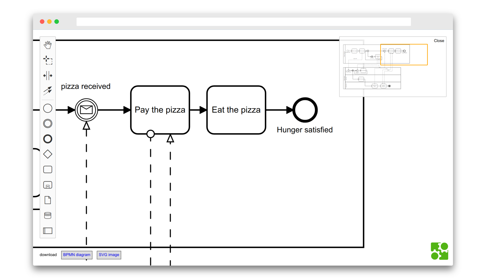

# diagram-js Minimap

[](https://github.com/bpmn-io/diagram-js-minimap/actions/workflows/CI.yml)

A minimap for diagram-js.




## Features

* See the whole diagram in the minimap
* Highlight current viewport
* Click/drag/scroll the minimap to navigate the diagram
* Optimized to not impact modeling performance

## Usage

Extend your diagram-js application with the minimap module. We'll use [bpmn-js](https://github.com/bpmn-io/bpmn-js) as an example:

```javascript
import BpmnModeler from 'bpmn-js/lib/Modeler';

import minimapModule from 'diagram-js-minimap';

var bpmnModeler = new BpmnModeler({
  additionalModules: [
    minimapModule
  ]
});
```

For proper styling integrate the embedded style sheet:

```html
<link rel="stylesheet" href="diagram-js-minimap/assets/diagram-js-minimap.css" />
```

Please see [this example](https://github.com/bpmn-io/bpmn-js-examples/tree/master/minimap) for a more detailed instruction.


## Configuration

The minimap can be configured via the `minimap` configuration option:

```javascript
var bpmnModeler = new BpmnModeler({
  additionalModules: [
    minimapModule
  ],
  minimap: {
    open: true,             // open the minimap by default (default: false)
    debounceDelay: 100,     // batch element updates within this delay, in ms (default: 100)
    debounceSkipDelay: 2000 // force a refresh at least every this delay, in ms (default: 2000)
  }
});
```


### Ancestor levels (proof of concept)

Roots can be nested, for instance when subprocesses are drilled down into as planes in [bpmn-js](https://github.com/bpmn-io/bpmn-js). The minimap always shows the active root. With `parentContext` it additionally lists the levels above it, collapsed by default, so users keep their bearings:

```javascript
minimap: {
  parentContext: function(activeRoot) {

    // levels, outermost first; return null for none
    return [
      { root: outerRoot, focus: shapeLeadingToNextLevel, label: 'Order process' },
      { root: innerRoot, focus: otherShape, label: 'Check items' }
    ];
  },

  // optional: replace "Parent:", "2 levels up:", ... (string or function of the distance)
  parentContextPrefix: function(distance) {
    return distance === 1 ? 'Parent:' : distance + ' levels up:';
  }
}
```

Each level is `{ root, focus, label }`: the root to draw, the element on it to highlight, and a caption. A level expands on click; expanded levels zoom with Ctrl + wheel (or pinch), pan by dragging, reset on double click and zoom in place on hover.

## License

MIT
